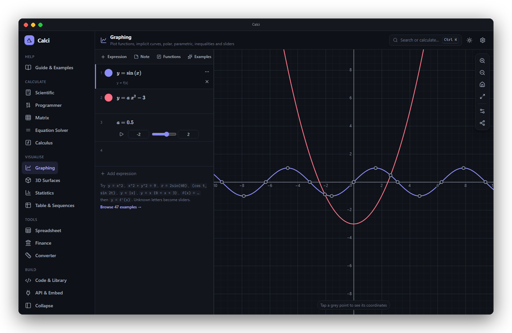

<!-- calci-header -->
<div align="center">


# Calci — desktop

**The all-in-one advanced calculator as a fast, fully offline desktop app for Windows, macOS and Linux, with a mini mode, always-on-top and a global hotkey.**

<a href="https://github.com/flamekaizen/CALCI-D/releases/latest"></a>


<a href="LICENSE"></a>

<a href="https://github.com/flamekaizen/CALCI-D/releases/latest"><b>⬇ Download for Windows, macOS or Linux</b></a> &nbsp;|&nbsp; <a href="https://calci-web.vercel.app">Try it in the browser</a>

<sub>Part of the Calci family &nbsp;—&nbsp; <a href="https://github.com/flamekaizen/CALCI-W">🌐 Web</a> &nbsp;·&nbsp; <b>🖥️ Desktop</b> &nbsp;·&nbsp; <a href="https://github.com/flamekaizen/CALCI-M">📱 Mobile</a></sub>

<br/><br/>




</div>
<!-- calci-header -->

Desktop app for **Calci**, the all-in-one advanced calculator. It runs the Calci web app
([CALCI-W](https://github.com/flamekaizen/CALCI-W)) inside [Electron](https://www.electronjs.org), fully offline,
with desktop extras:

- **Mini calculator** (`Ctrl/⌘ + M`): a compact, always-on-top window
- **Always on top** toggle (`Ctrl/⌘ + Shift + T`)
- **Global shortcut** `Ctrl/⌘ + Alt + C` to show or hide Calci from anywhere
- Native menus with every mode on `Ctrl/⌘ + 1…9`
- Theme-aware title bar, remembered window size / position, single instance
- Secure by default: context isolation, sandboxed renderer, no Node in the page, files served
  from a private `app://` protocol, external links open in your browser

## Download

Open the repository’s **Releases** page and download:

- **Windows:** `Calci-Setup-<version>-x64.exe` (installer with Start-menu shortcut) or `Calci-Portable-<version>.exe` (no install)
- **macOS:** the `.dmg`  ·  **Linux:** the `.AppImage` or `.deb`

The builds are not code-signed yet. Windows SmartScreen shows “Windows protected your PC” → **More info → Run anyway**. If **Smart App Control** is turned on in Windows Security, it blocks unsigned apps completely; use `npm start` from a clone instead, or sign the app (see Releases below).

## Run & build

```bash
npm install
npm start               # run the app
npm run dist:win        # Windows installer (NSIS) + portable .exe → release/
npm run dist:mac        # macOS .dmg (on macOS)
npm run dist:linux      # AppImage + .deb (on Linux)
```

Update the bundled web app after changing CALCI-W (expects it next to this folder, or set `CALCI_WEB_DIR`):

```bash
npm run sync:web
```

## Releases

Push a tag such as `v1.0.0` and `.github/workflows/release.yml` builds Windows, macOS and Linux packages
and attaches them to a GitHub release. Builds are unsigned: Windows SmartScreen and macOS Gatekeeper will
warn until you add code-signing certificates (`CSC_LINK` / `CSC_KEY_PASSWORD`, Apple notarisation).

## Licence

MIT © flamekaizen. Third-party notices ship inside the app (`app/licenses.txt`).
